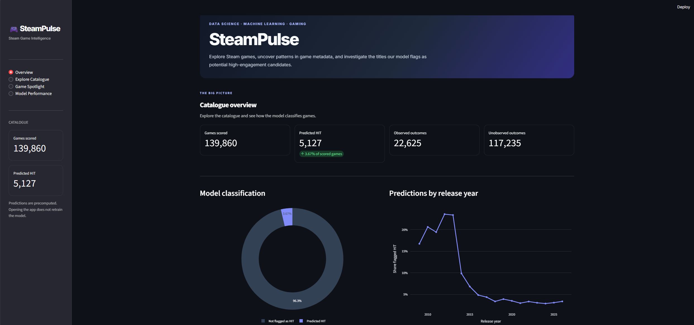
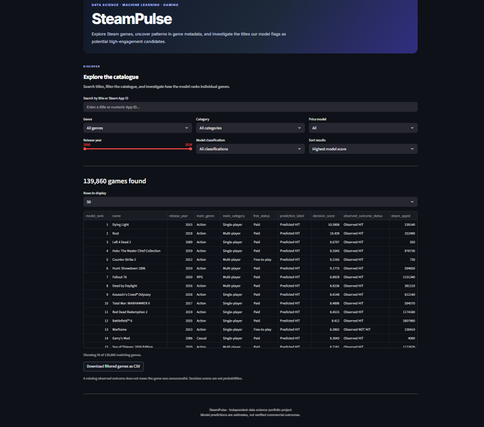
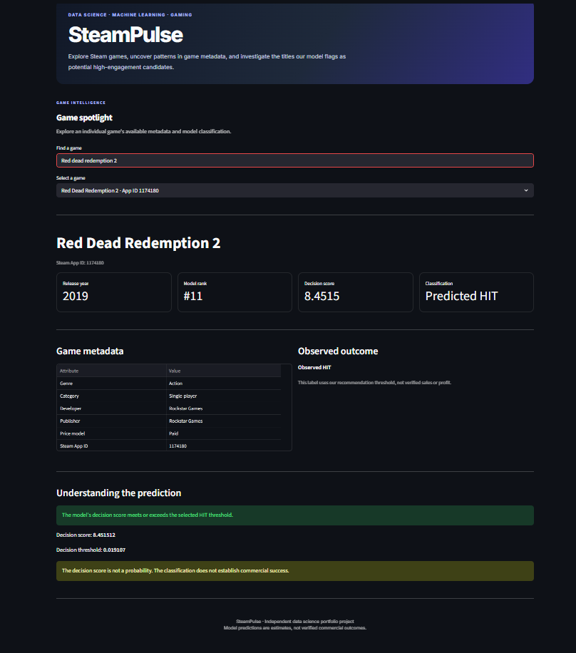
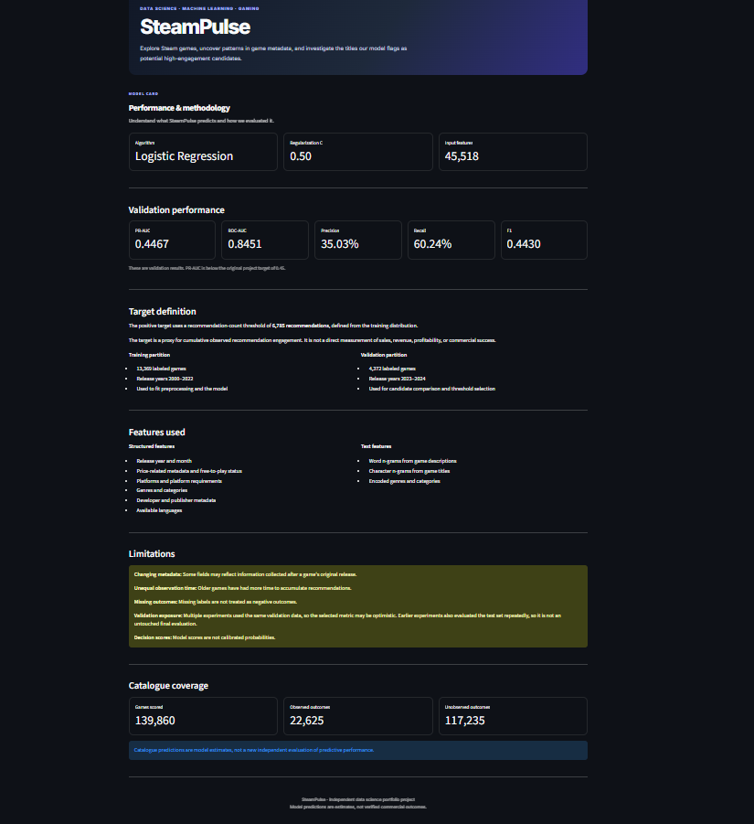

# SteamPulse

SteamPulse is a data science and machine learning project focused on exploring Steam games and analysing patterns in game metadata. It combines data collection, data cleaning, feature engineering, machine learning, and an interactive Streamlit application.

The project uses a catalogue of 139,860 Steam games to explore game information and examine machine learning classifications associated with observed recommendation engagement.


## Application Overview

SteamPulse is an interactive Streamlit Steam game analytics application. The Application can be launched through this link **[SteamPulse](https://steam-pulse.streamlit.app/)**.

### Overview

Explore catalogue statistics, the distribution of model classifications, release year patterns, and the highest ranked games.



### Explore Catalogue

Search games by title or Steam App ID. Filter by genre, category, price model, release year, and model classification. Sort the results and download filtered records as a CSV file.





###  Game Spotlight

Inspect an individual game's available metadata, model ranking, decision score, classification, and observed outcome status.



---

###  Model Performance

Review the target definition, validation results, features, evaluation methodology, and limitations.



## Dataset

The scored catalogue contains 139,860 unique Steam Game App IDs.

| Statistic | Value |
|---|---:|
| Games scored | 139,860 |
| Games with observed target labels | 22,625 |
| Games without observed target labels | 117,235 |
| Predicted HIT classifications | 5,127 |
| Share classified as HIT | 3.67% |

The catalogue includes game information and the output of the SteamPulse model. The predictions are intended for exploration and analysis, not as verified measures of commercial success.

A game classified as HIT is one that meets the model's selected decision threshold. A game that is not flagged as HIT should not automatically be considered unsuccessful.

Games without observed target labels still receive predictions, but their outcomes cannot be verified using the available data.


## Data Collection and Sources

The Steam game metadata and the Exploratory Data Analysis used as the starting point for SteamPulse is available on Kaggle.

**Dataset:** [Steam Games Metadata: 185K Records from Steam API](https://www.kaggle.com/datasets/fardinahm3d/steam-games-metadata-185k-records-from-steam-api)

**Explanatory Data Analysis:** (https://www.kaggle.com/code/fardinahm3d/notebook-steam-game-metadata)

the Steam game metadata was collected using Python scripts that interacted with Steam's catalogue and store endpoints. Steam Web API key was obtained and used for API requests that required key based authentication.

The collection process involved retrieving game records, saving the results to CSV files, and processing the collected data for analysis and machine learning. Additional scripts were used to clean records, inspect data quality, correct price units, and prepare the modelling dataset.

The collection process encountered API rate limits, failed requests, and some malformed CSV records. These issues required additional data inspection and recovery steps. 

The API key is not included in the public repository. Anyone wishing to reproduce the collection can request the web API key through steam. The Python Script for obtaining data through API Key is available in SRC/Data/collect_data.py

## Data Rights

The collected game information comes from Steam related catalogue and store endpoints. Game names, descriptions, metadata, and other third party material remain subject to the rights of Valve.

SteamPulse is an independent data science and machine learning project. It is not affiliated with Valve or Steam.

## Machine Learning Approach

The selected model is Logistic Regression with a regularization parameter of `C = 0.5`.

The model combines structured game metadata with text features extracted from game descriptions and titles. The feature processing pipeline includes text vectorization, categorical encoding, and numerical preprocessing.

### Target Definition

The positive class is defined using a threshold of 6,785 observed Steam recommendations. This threshold was derived from the training distribution.

The target represents a proxy for cumulative recommendation engagement. It does not directly measure units sold, revenue, profit, player retention, or commercial success.

The selected decision score threshold is approximately `0.019107`. This is a threshold applied to the model's decision score, not a probability threshold.

## Validation Results

The selected model produced the following validation results.

| Metric | Result |
|---|---:|
| Average precision | 0.4467 |
| ROC AUC | 0.8451 |
| Precision | 35.03% |
| Recall | 60.24% |
| F1 score | 0.4430 |

The validation set contains 4,372 labelled games released during 2023 and 2024.

Precision, recall, and F1 were calculated using the selected decision score threshold.

The original average precision target was 0.45. The final result of 0.4467 is slightly below that target.

These metrics describe performance on the validation set. They should not be interpreted as guaranteed performance across the entire Steam catalogue.

## Technology

The project uses the following tools and libraries.
-
- Python
- pandas and NumPy
- scikit learn
- TF IDF text features
- Logistic Regression
- Plotly 
- Streamlit

## Project Structure

```text
SteamPulse/
├── App/
│   └── app.py
├── Data/
│   └── Processed/
│       └── steampulse_catalog_predictions.csv
├── Models/
│   └── steampulse_release_candidate.joblib
├── Reports/
│   ├── steampulse_release_candidate_validation.json
│   └── steampulse_catalog_scoring_summary.json
├── docs/
│   └── PROJECT_CHALLENGES.md
├── requirements.txt
├── .gitignore
└── README.md
```

Large raw datasets and most intermediate modelling files are excluded from the public repository to keep it manageable. These files remain in the local project directory.

## Running the Application

Install the required dependencies from the project root.

```bash
python -m pip install -r requirements.txt
```

Start the Streamlit application.

```bash
python -m streamlit run App/app.py
```

The application requires the following files.

- `Data/Processed/steampulse_catalog_predictions.csv`
- `Reports/steampulse_release_candidate_validation.json`
- `Reports/steampulse_catalog_scoring_summary.json`

The dashboard reads precomputed predictions rather than generating new predictions when a visitor opens the application.

The packaged model is included as a reproducibility artifact.

## Limitations

The model predicts a proxy for cumulative recommendation engagement, not verified commercial success.

Most games in the catalogue do not have an observed target label in the available dataset. Missing outcomes are not treated as negative outcomes.

Older games have had more time to accumulate recommendations than newer games. In addition, some metadata may have been collected or updated after a game launched. The model has not been validated as a strictly pre release forecasting system.

Multiple experiments used the same validation data. Earlier experiments also evaluated the test set repeatedly, so the test set should not be described as an untouched final evaluation.

Price corrections and currency conversions do not reconstruct historical launch time prices. Model decision scores are not calibrated probabilities.

Further details about data collection issues, data quality, price corrections, modelling experiments, evaluation, and application development are documented in [Project Challenges](docs/PROJECT_CHALLENGES.md).


